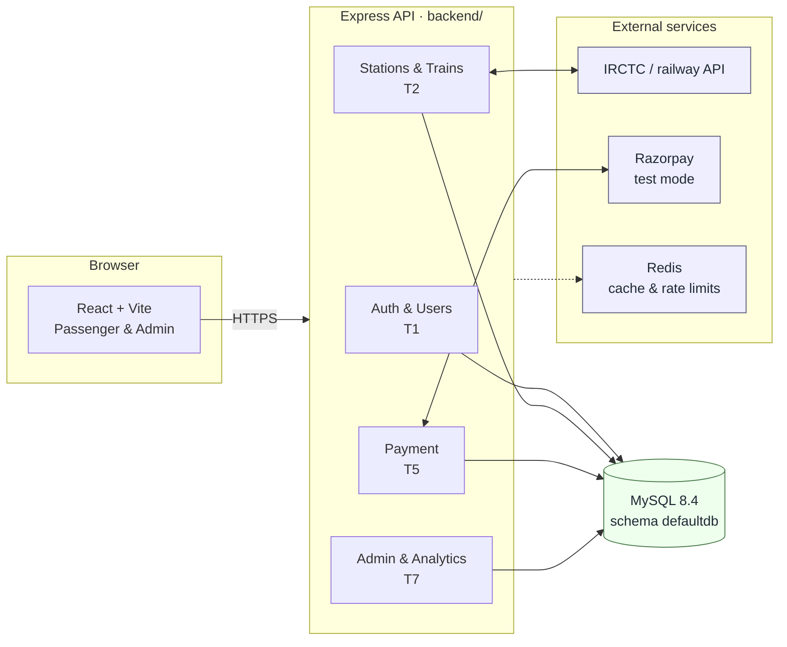
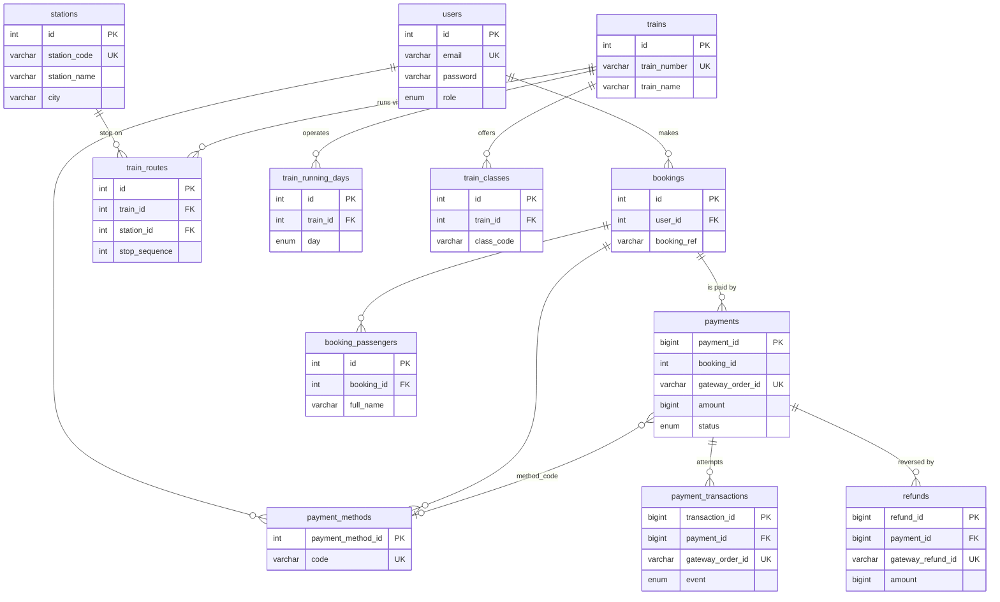

<div align="center">


### Move Beyond Limits

*A railway booking platform — live train search, PNR status, live tracking, and a full booking flow with Razorpay test payments.*

<br>


<br>

**[Overview](#-project-overview) · [Features](#-features) · [Tech Stack](#-tech-stack) · [Structure](#-project-structure) · [Run](#-how-to-run-the-project) · [Env](#-environment-variables) · [Status](#-project-status)**

</div>

<br>

## 🚆 Project Overview

Yatrio is a railway reservation and management system: passengers search for
trains, book a seat and pay through Razorpay, while administrators manage the
network and watch the numbers.

> Payments run in **Razorpay TEST MODE**, and every booking, PNR and ticket is a
> **demo artifact** — no real IRCTC ticket booking is performed.

The frontend is React + Vite, the backend is a single Express API serving every
team, and all seven teams share one MySQL schema.



### The data model

One schema, seven teams, stable table ownership.



> `booking_passengers`, `train_routes`, `train_running_days` and `train_classes`
> come from Teams 3 and 4 and are the tables those teams' migrations create.
> Team 5's four tables are detailed in [`PAYMENTS.md`](PAYMENTS.md) §12.

---

## ✨ Features

### 👤 Passenger

* Railway/train search
* Train details and route information
* Passenger details management
* Seat selection
* Ticket booking
* Booking review
* Payment interface
* PNR status
* My bookings
* Ticket/booking details
* Profile management

### 🛠️ Admin

* Dashboard
* Train management
* Station management
* Schedule management
* Booking management
* User management
* Fare management
* Reports
* Audit logs

---

## 🛠️ Tech Stack

### Frontend

* **React 18** + **Vite**
* **React Router 7**
* **TanStack Query 5**
* **CSS** (design system in [`brandkit.md`](brandkit.md))
* **Lucide Icons**

### Backend

* **Node.js 18+**
* **Express 5**
* **Sequelize 6** + **mysql2** — one shared connection layer for every team
* **JWT Authentication** + **bcryptjs**
* **Razorpay** — test mode, server-side signature verification
* **express-rate-limit** + **ioredis**
* **dotenv**

### Database

* **MySQL 8.4** — one schema, `defaultdb`, shared by all seven teams
  * **Hosted:** Aiven, reached over TLS and verified against its CA
  * **Local:** `yatrio_db`, created by `npm run db:migrate`
  * 15 tables · 5 views · 12 stored procedures · 11 triggers
  * Access it for every team through one Sequelize layer:
    [`backend/README.md`](backend/README.md) · connect and browse:
    [`backend/database/README.md`](backend/database/README.md)
  * Team 5's payment schema in detail, with an ER diagram:
    [`PAYMENTS.md`](PAYMENTS.md) §12
* **Redis 7** *(optional)* — station cache and API rate limits.
  See [`backend/REDIS_DOCUMENTATION.md`](backend/REDIS_DOCUMENTATION.md)

---

## 📁 Project Structure

```text
Yatrio/
├── backend/
│   ├── src/
│   │   ├── config/
│   │   ├── controllers/
│   │   ├── middleware/
│   │   ├── models/
│   │   ├── routes/
│   │   ├── services/
│   │   ├── utils/
│   │   └── server.js
│   ├── database/          # Team 5 — Sequelize migrations, seeders, SQL, certs
│   ├── migrations/        # raw SQL, applied by runMigrations.js
│   ├── tests/
│   ├── package.json
│   └── package-lock.json
│
├── public/
├── src/
│   ├── api/
│   ├── assets/
│   ├── components/
│   │   ├── auth/
│   │   ├── layout/
│   │   └── ui/
│   ├── context/
│   ├── data/
│   ├── layouts/
│   ├── pages/
│   │   ├── admin/
│   │   ├── passenger/
│   │   └── public/
│   ├── services/
│   ├── utils/
│   ├── App.jsx
│   ├── main.jsx
│   └── router.jsx
│
├── package.json
├── package-lock.json
├── vite.config.js
├── jsconfig.json
└── README.md
```

---

## ▶️ How to Run the Project

## 1. Clone the Repository

```bash
git clone https://github.com/8DMuscian/Yatrio.git
```

Navigate into the project:

```bash
cd Yatrio
```

---

## 2. Install Frontend Dependencies

From the project root:

```bash
npm install
```

---

## 3. Install Backend Dependencies

Navigate to the backend:

```bash
cd backend
```

Install the backend dependencies:

```bash
npm install
```

Then return to the project root:

```bash
cd ..
```

---

## 🔐 Environment Variables

The backend reads everything from `backend/.env`. Copy the template and fill it
in:

```bash
cd backend
cp .env.example .env
```

The groups that matter:

```env
# ---- Server ----
PORT=5000
JWT_SECRET=your_secret_key

# ---- Database (MySQL) ----
# Hosted Aiven instance — note the port is NOT 3306.
DB_HOST=mysql-yatrio-kharadeprathamesh7.b.aivencloud.com
DB_PORT=11499
DB_NAME=defaultdb
DB_USER=avnadmin
DB_PASSWORD=<from the Aiven console>
# TLS, verified against Aiven's CA that ships with the repo
DB_SSL=true
DB_SSL_CA=database/certs/aiven-ca.pem

# ---- Razorpay (test mode) ----
RAZORPAY_KEY_ID=rzp_test_...
RAZORPAY_KEY_SECRET=...

# ---- Redis (optional) ----
REDIS_HOST=127.0.0.1
REDIS_PORT=6379
```

> **Never commit `.env`.** It is gitignored. Only `VITE_RAZORPAY_KEY_ID` ever
> reaches the browser — Vite inlines every `VITE_*` variable into the bundle, so
> a secret placed there is published. See [`SECURITY.md`](SECURITY.md).

Full list: [`backend/.env.example`](backend/.env.example).

---

## 🚀 Start the Application

The frontend and backend should be run in **two separate terminals**.

## Terminal 1 — Start Backend

From the project root:

```bash
cd backend
npm run dev
```

The backend will start using Nodemon.

You should see output similar to:

```text
[nodemon] starting `node src/server.js`
```

---

## Terminal 2 — Start Frontend

Open another terminal and go to the project root:

```bash
cd Yatrio
```

Then run:

```bash
npm run dev
```

Vite will display the local development URL, usually something similar to:

```text
http://localhost:5173
```

Open that URL in your browser.

---

## 🔄 Running Both Servers

You need both servers running at the same time:

```text
Terminal 1
──────────────
cd backend
npm run dev

        ↓

Backend
http://localhost:5000
```

and:

```text
Terminal 2
──────────────
npm run dev

        ↓

Frontend
http://localhost:5173
```

The frontend communicates with the backend through the configured API endpoints.

---

## ☁️ Deploying the frontend

The frontend is a static Vite build deployed as a **Cloudflare Worker**
(assets-only — no Worker script). `Frontend/wrangler.jsonc` holds all the
config:

```jsonc
{
	"name": "yatrio",
	"compatibility_date": "2026-10-11",
	"assets": {
		"directory": "./dist",
		"not_found_handling": "single-page-application"
	}
}
```

Build settings in the Cloudflare dashboard:

| Setting | Value |
| --- | --- |
| Root directory | `Frontend` |
| Build command | `npm run build` |
| Deploy command | `npx wrangler deploy` |
| Preview command | `npx wrangler preview` (default) |
| Node version | 18 or newer |

> `"name"` must match the Worker's name on the dashboard (`yatrio`) exactly, or
> `wrangler deploy` aborts.

> **Keep `wrangler.jsonc`.** Without it, wrangler 4.68+ falls back to
> *auto-config*, which parses `vite.config.js` and fails with
> `Error parsing file: .../vite.config.js`. Any config file disables it.

### Environment variables

Set these in the Cloudflare dashboard under build environment variables:

```text
VITE_API_URL=https://your-backend-host      # origin only, no /api prefix
VITE_USE_MOCK_DATA=false                     # once real endpoints exist
```

Vite inlines `VITE_*` variables **at build time**, so these must be set before
the build runs — changing them afterwards has no effect until a rebuild.

> **Why the root loads but every other link 404s.** The app uses
> `createBrowserRouter`, so every route is client-side. A static host looks for
> a file at each path and finds none, so it returns 404 — while `/` works,
> which is what makes it look random. `assets.not_found_handling` fixes it by
> serving `/index.html` for any request that matches no asset.
>
> If you ever deploy the frontend somewhere else, the equivalent is "rewrite
> all unmatched paths to `/index.html`". On Cloudflare **Pages** that is the
> `public/_redirects` file syntax, which is why it is not used here.

### Preview deployments

Every branch that is not your production branch gets its own isolated Preview,
served on its own URL under the same Worker. The enabling config is one line:

```jsonc
"previews": {}
```

An empty object is correct and intentional here. The `previews` block is
*required* for Worker Previews, but this Worker is assets-only — it has no
bindings, vars, or Worker script, so there is nothing to override.

Two rules worth knowing:

- **`assets` must stay at the top level**, never inside `previews`.
  `wrangler preview` uploads assets from the branch being previewed.
- **Do not put `VITE_*` in the `previews` block.** Vite inlines those at build
  time, and an assets-only Worker has no runtime to read `env` from. Preview
  builds need `VITE_API_URL` set as a build environment variable in the
  dashboard, just like production builds do.

Requires wrangler **4.135.0+**. The build fetches wrangler via `npx`, so it is
already current; if you later add it as a local dev dependency, pin `>=4.135.0`.

Each Preview gets a **Preview URL** (always the latest deploy) and a
**Deployment URL** per deploy (immutable, for comparing exact versions).
`workers.dev` Preview URLs carry `X-Robots-Tag: noindex`, so they will not be
indexed by search engines.

### Deploying the backend

The backend is a Node/Express app, not yet deployed. It cannot run on
Cloudflare Workers without a compatibility flag and some adaptation — treat
that as separate work, and set `VITE_API_URL` once it has a public URL.

---

## 🧪 Development

### Frontend

```bash
npm run dev
```

### Backend

```bash
cd backend
npm run dev
```

### Build Frontend

```bash
npm run build
```

### Preview Production Build

```bash
npm run preview
```

---

## 🔮 Future Development

The project can be extended with:

* User authentication and authorization
* Train and station APIs
* Real-time train search
* Database-driven seat availability
* Ticket booking
* Automatic PNR generation
* Booking cancellation
* Fare calculation
* Payment processing
* RAC/waitlist management
* Administrative APIs
* Reports and analytics

---

## 📌 Project Status

| Component | Status |
| --- | --- |
| Frontend | ✅ Completed — passenger, admin and payment screens |
| Backend | ✅ Completed — one Express API, four modules mounted at the root |
| Database | ✅ 15 tables, 5 views, 12 stored procedures, 11 triggers — one MySQL schema |
| API Integration | 🚧 Teams 3, 4 and 6 have not landed their endpoints yet |
| Authentication | ✅ Register, login, JWT and role middleware |

---

## 👨‍💻 Author

**Kharade Prathamesh Bajarang** — [8DMuscian](https://github.com/8DMuscian)

Built by a seven-team group project: Auth & Users, Railway Search, Train
Details, Booking & Passengers, Payment & Transactions, PNR & Live Tracking, and
Admin & Analytics.

---

## 📄 License

This project is developed for educational and development purposes.

---

## Team 7: Admin, Analytics & System Infrastructure

### Scope
Team 7 implements the administrative observation, reporting, and system control layer. This includes the internal React admin shell, authentication guards, dynamic dashboard charting, and deep backend integrations for operational visibility.

### Frontend Routes (React)
- `/admin/login` - Premium Yatrio administrative authentication
- `/admin` - Operational dashboard overview
- `/admin/users` - Passenger and admin management
- `/admin/trains` - Fleet read-only observation
- `/admin/bookings`, `/admin/payments`, `/admin/cancellations` - Transactional interfaces
- `/admin/monitoring` - Real-time system telemetry and API health logs
- `/admin/reports` - Dynamic datasets with CSV export capabilities
- `/admin/analytics` - Visual charting workspaces
- `/admin/audit-logs` - Security event timeline

### Backend Routes (Express)
Mounted under `/admin/`:
- `GET /dashboard`, `GET /users`, `GET /trains`, `GET /bookings`, `GET /payments`, `GET /cancellations`, `GET /audit-logs`, `GET /reports`, `GET /analytics`, `GET /monitoring`, `GET /monitoring/api`, `GET /monitoring/pnr`

### Database Objects (MySQL)
- **Tables**: `audit_logs`, `api_request_logs`
- **Views**: `vw_booking_summary`, `vw_revenue_summary`, `vw_train_occupancy`, `vw_user_activity`
- **Procedures**: `get_dashboard_statistics()`, `get_daily_revenue()`, `get_popular_routes()`, `get_train_occupancy()`
- **Indexes**: Includes composite `idx_users_role_status` and timestamp filters for telemetry tables.

### Caching & Telemetry (Redis)
Team 7 utilizes `ioredis` strictly connected to `127.0.0.1:6379`. It provides:
- Automatic short-TTL caching for heavy dashboard KPI queries.
- Health telemetry tracking inside `/admin/monitoring`.
- API request rate limiting.

### Demo Limitations & Cross-Team Integrations
Team 7 respects strict cross-team domain boundaries. Specifically, **Team 4 (Bookings)**, **Team 5 (Payments)**, and **Team 6 (PNR Live)** schemas are currently pending migration integrations.

**Until these tables become active:**
- The frontend displays honest `"Integration Pending"` empty states for booking and payment management pages.
- The dashboard and analytics engine will dynamically estimate `"proxy revenue"` and booking volume snapshots strictly via the `train_classes.available_seats` metric. No transactional fields are fabricated. As soon as the respective teams' schemas are integrated into the MySQL DB, these admin interfaces will instantly consume the live data.
