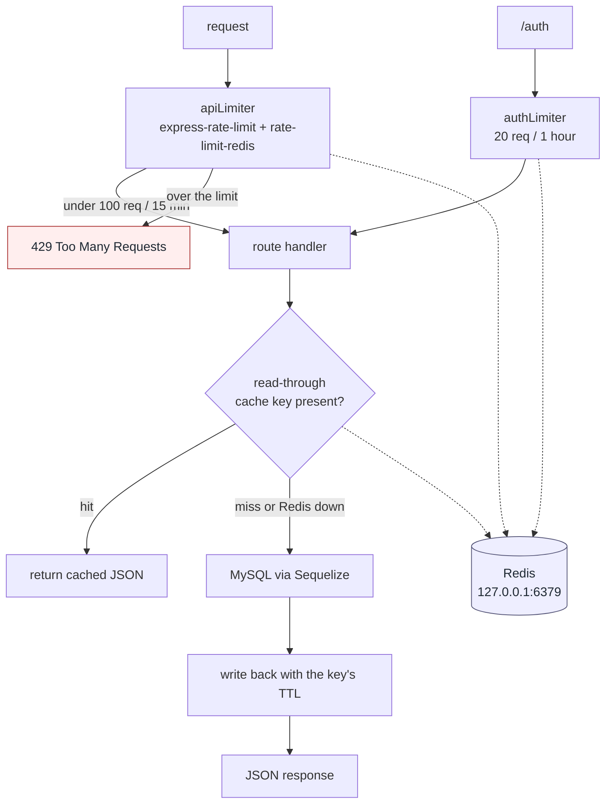

# Yatrio Redis Cache Configuration

This document outlines the Redis infrastructure built by Team 7 and how it integrates with the rest of the Yatrio backend (e.g., Team 2).

## Configuration
Redis configuration is centrally managed in `backend/src/config/redis.js` (values resolved in `backend/src/config/env.js`). The application connects to Redis using the `ioredis` package. 

Ensure the following environment variables are set in your `.env` file:
```env
REDIS_ENABLED=true
REDIS_HOST=127.0.0.1
REDIS_PORT=6379
REDIS_PASSWORD=
REDIS_DB=0
```

Set `REDIS_ENABLED=false` on a machine that will never run Redis. The client
is then never constructed, which keeps the startup log silent and skips the
background reconnect attempts.

## Shared Middlewares & Tools
- **Rate Limiting**: We use `express-rate-limit` with `rate-limit-redis`.
  - API Limiter: Limits to 100 requests / 15 minutes globally (prefixed with `rl:api:`).
  - Auth Limiter: Limits to 20 requests / 1 hour for auth routes (prefixed with `rl:auth:`).
- **Health Check**: `checkRedisHealth()` is exported from `src/config/redis.js` and returns a boolean confirming if Redis is reachable.

## Backward Compatibility (Team 2)
The original in-memory `cacheService.js` created by Team 2 has been swapped for a Redis-backed `CacheService` class, exposing the same API methods (`get`, `set`, `del`, `flush`, `size`). These methods are now asynchronous. Team 2's `railwayService.js` was safely updated to `await` the responses.

## Where Redis sits in the request path

Redis is optional. When it is unreachable the API degrades rather than failing:
cache reads miss and fall through to MySQL, and the rate limiter falls back to
in-memory counting. Every request below still succeeds, just uncached.

Degrading has to mean degrading *fast*, which is why the client sets
`enableOfflineQueue: false`. ioredis otherwise parks commands issued while
disconnected in an offline queue and replays them once a connection lands, so a
Redis outage turned every cached route into a multi-second wait before it
finally rejected — the requests did not fail, they just took 7-12s. Rejecting
immediately returns that path to its uncached timing (~0.2s), while the
background reconnect still picks Redis back up without a restart.

The outage is reported once, naming the host and how to silence it, rather than
on every request.



Team 2's original in-memory `cacheService.js` was replaced by this Redis-backed
one, with the same API (`get`, `set`, `del`, `flush`, `size`), now async —
`railwayService.js` awaits the responses.

## Key and TTL Glossary
Keys are structured using namespaces separated by colons.

| Key Pattern | Description | Default TTL (Seconds) |
| --- | --- | --- |
| `stations:all:{page}:{limit}:{search}` | Paginated/filtered station list | 180 (3 mins) |
| `stations:search:{query}:{limit}` | Auto-complete station search | 180 (3 mins) |
| `trains:between:{from}:{to}:{date}` | Trains running between two stations | 60 (1 min) |
| `train:details:{trainNo}` | Comprehensive train and route details | 300 (5 mins) |
| `rl:api:{ip}` | API Rate Limit tracker | 900 (15 mins) |
| `rl:auth:{ip}` | Auth Rate Limit tracker | 3600 (1 hour) |

To flush the entire database manually via CLI:
```bash
redis-cli -n 0 flushdb
```
