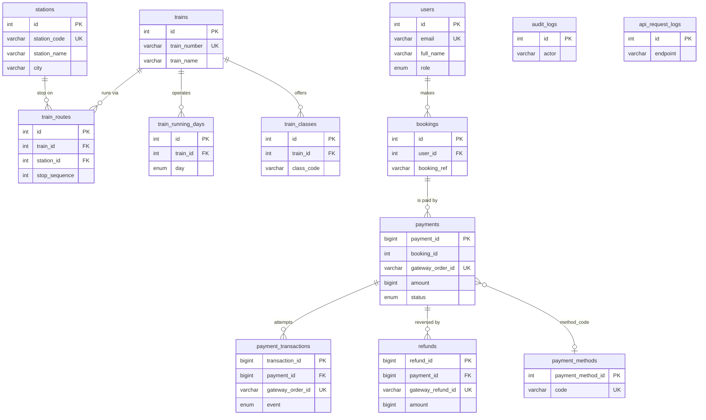
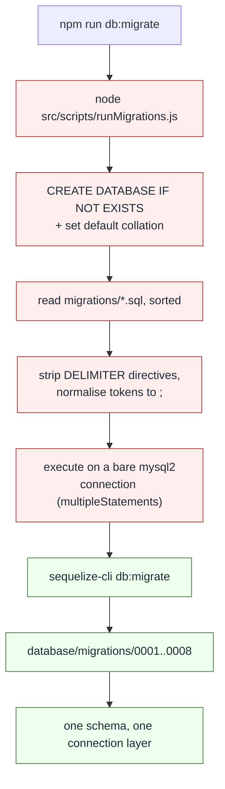

# Working with the Yatrio database

**One MySQL database for the whole project** — MySQL 8.4.8, hosted on Aiven,
schema `defaultdb`. All seven teams share it. Team 5 built the payment tables
and the migration tooling; everyone else uses the same connection.

For what a particular module's schema is and why it is shaped that way, see the
team's own document — [`../../PAYMENTS.md`](../../PAYMENTS.md) §12 for payment.
This file is the shared manual: how to connect, what is in there today, and the
rules that keep seven teams from colliding in one schema.

| | |
| --- | --- |
| **[MySQL Workbench](#mysql-workbench)** | a GUI. Browse the schema tree, click a table to see its rows, no typing |
| **[The MySQL client](#the-mysql-client)** | the terminal. Precise, scriptable, and what `npm run db:shell` wraps |

Both need the same connection details and the same TLS setup, which are listed
once below rather than repeated.

---

## Connection details

| Field | Value |
| --- | --- |
| Hostname | `mysql-yatrio-kharadeprathamesh7.b.aivencloud.com` |
| Port | **`11499`** |
| Username | `avnadmin` |
| Password | copy it from `backend/.env` → `DB_PASSWORD` |
| Schema | `defaultdb` |
| CA certificate | `backend/database/certs/aiven-ca.pem` |

> ### The port is 11499, not 3306
>
> Aiven assigns a port per service, and 3306 is the number everyone reaches
> for first. Using it gives you `ERROR 2003 Can't connect`.

Two of those rows carry most of the weight:

- **The password is only ever in `.env`.** It is deliberately absent from this
  file and from every committed file in the repo. See
  [`../../SECURITY.md`](../../SECURITY.md). If you are setting up on a new
  machine, copy `backend/.env.example`, then fill in `DB_HOST`, `DB_PORT`,
  `DB_NAME`, `DB_USER` and `DB_PASSWORD` from the Aiven console — it hands you
  a Service URI, which is those five values in one string. Drop the
  `?ssl-mode=REQUIRED`; `DB_SSL` and `DB_SSL_CA` below do that job.
- **The CA certificate is not optional.** It is what makes a client *verify*
  that the server is who it claims to be. Without it the connection is only
  encrypted — anyone able to intercept it could present any certificate — and
  clients will either warn or fail with `ERROR 2026`.

There is one credential for the project. There is no per-team login, so
treat the password as shared: put it in your own `.env`, never in a commit and
never in a screenshot.

### Why the certificate is in the repository

`aiven-ca.pem` is a **certificate**, not a key, and it is public material —
the same way a website's TLS certificate is. TLS verification only works
because the client is handed the issuer it should trust, so there is nothing
secret about distributing one.

What is in the file:

```
subject=CN=7a9bd0ea-015e-4934-9222-7e8036c69a7d Project CA
issuer=CN=7a9bd0ea-015e-4934-9222-7e8036c69a7d Project CA
notBefore=Oct  5 14:18:39 2026 GMT
notAfter=Oct  2 14:18:39 2036 GMT
```

A name, a validity window and a signature. **No private key block.** It cannot
decrypt traffic, cannot authenticate anyone to the database, and cannot let
anyone impersonate Aiven. A copy of it plus no password is worth nothing —
the password is the only part that matters, and that stays in `.env`.

Committing it is also just convenient: without the file here, every teammate
has to dig the certificate out of the Aiven console and place it by hand,
which is a much worse way to lose track of a credential than not having one
hidden at all.

What must **never** be committed: any file containing a private key — the
project's CA key, a client certificate with its key, an `.ssh` key — and any
`my.cnf`/`my.ini` holding the password. Check before committing:

```bash
grep -rlE "BEGIN (RSA |EC |OPENSSH |PGP )?PRIVATE KEY" --exclude-dir=node_modules .
```

---

## What lives here

Seven teams, one schema. **Own your tables; leave everyone else's alone.**

| Team | Module | Tables | Status |
| --- | --- | --- | --- |
| T1 | Auth | `users` | **created** |
| T2 | Search | `stations`, `trains`, `train_routes`, `train_running_days`, `train_classes` | **created and seeded** |
| T3 | Availability | `train_schedules`, `seat_classes`, `quotas`, `fares`, `availability_snapshots` | not created yet |
| **T3/T5** | **Seat inventory** | **`coaches`, `coach_seats`** (built by T5 against T3's contract) | **created and seeded** |
| T4 | Booking | `bookings`, `booking_passengers`, `booking_segments`, `seat_allocations`, `booking_status`, `cancellations` | not created yet |
| **T5** | **Payment** | **`payments`, `payment_transactions`, `refunds`, `payment_methods`** | **created and seeded** |
| **T5** | **Seat holds** | **`seat_inventory`, `seat_holds`** | **created** |
| T6 | PNR / Live | `pnr_records`, `pnr_passengers`, `train_live_status`, `train_locations`, `train_status_history` | not created yet |
| T7 | Admin / Audit | `audit_logs`, `api_request_logs`, `railway_audit_logs` | **created** |

Teams 1, 2, 5 and 7 have landed their schema. Teams 3, 4 and 6 have not — and
Team 4's `bookings` is the one that matters to others, because
`payments.booking_id` is indexed and **waiting** for it.
[`PAYMENTS.md`](../../PAYMENTS.md) §12.8 has the `ALTER TABLE` that closes that
loop.

## `coaches`, `coach_seats`, `seat_inventory`, `seat_holds` — Team 5

A berth is booked for a **run of adjacent segments**, not for a whole journey, so
it can be sold again from the next station along. Occupancy is a bitmask with one
bit per segment; two bookings share a berth exactly when their masks do not
intersect.

This sits in Team 5's slice because it is bound to the payment window, but it is
the half of booking that can be made correct without `bookings`. When `bookings`
and the rest of Team 3/4's schema land, `seat_holds.booking_ref` becomes a real
foreign key and `train_classes.available_seats` — a static seed pair that never
tracked a booking — can be dropped in favour of counting live masks.

| Table | Grain | Key columns |
| --- | --- | --- |
| `coaches` | one carriage per (train, class) | `coach_id`; UNIQUE (`train_id`, `class_code`, `coach_code`) |
| `coach_seats` | one berth per coach | `seat_id`; UNIQUE (`coach_id`, `seat_code`) |
| `seat_inventory` | one row per **seat per journey date** | UNIQUE (`seat_id`, `departure_date`); `segment_mask BIGINT UNSIGNED` |
| `seat_holds` | one row per booking per seat | `from_stop_seq`, `to_stop_seq`, `segment_mask`, `status`, `expires_at` |

Indexes:

| Name | Columns | Why |
| --- | --- | --- |
| `idx_seat_holds_seat_date` | `seat_id`, `departure_date` | **Deliberately not unique.** A seat has several concurrent rows whenever their segments are disjoint. Uniqueness lives in `seat_inventory`. |
| `idx_seat_holds_booking_ref` | `booking_ref` | Release and confirm address a whole booking at once |
| `idx_seat_holds_expiry` | `status`, `expires_at` | The sweeper's only query |
| `chk_seat_holds_segment_span` | CHECK | `to > from` and the span fits in 64 bits |

`seat_inventory` is the seat lock. A claim is one conditional UPDATE —
`SET segment_mask = segment_mask | :mask WHERE ... AND (segment_mask & :mask) = 0`
— which MySQL evaluates under the row lock, so there is no read-then-write window.

Berths are seeded to match each class's `total_seats` exactly (5,134 across the
9 seeded trains), so availability can be derived by counting masks with a bit set
rather than read off a static counter.

See [`PAYMENTS.md`](../../PAYMENTS.md) §12.9 for the bitmask encoding, the
release rule and the pro-rata fare model.

See
[`PAYMENTS.md`](../../PAYMENTS.md) §12.9 for why, and §5 for the transaction
that makes a multi-seat booking all-or-nothing.

### Everything in the schema



`bookings` and `booking_passengers` are shown as Team 4 will create them; the
dashed relationship to `payments` is the one still to be enforced.

Also present, and not anybody's application data:

| Object | What it is |
| --- | --- |
| `v_payment_history` | T5 read-only view: one row per payment, the shape the history endpoint returns |
| `vw_booking_summary`, `vw_revenue_summary`, `vw_train_occupancy`, `vw_user_activity` | T7 reporting views for the admin dashboard |
| `create_payment_record`, `confirm_payment`, `process_refund` | T5 procedures — see [`PAYMENTS.md`](../../PAYMENTS.md) §12.5 |
| `search_stations`, `search_trains_between_stations` | T2 procedures, called by the search endpoints |
| `get_dashboard_statistics`, `get_daily_revenue`, `get_popular_routes`, `get_train_occupancy` | T7 procedures behind the analytics screens |
| `sequelize_meta`, `sequelize_seeders` | Sequelize's own. They record which migrations and seeders have run |

### How the schema gets built

Two migration systems, one `npm run db:migrate`.



The raw runner opens its own connection only because it must `CREATE DATABASE`
before a schema exists and needs `multipleStatements` for the SQL files. Every
line the application executes afterwards goes through Sequelize.

The four live tables as a full ER diagram — every column, key and constraint —
is in [`PAYMENTS.md`](../../PAYMENTS.md) §12.3.

---

## Rules for everyone

- **Schema changes ship as migrations.** `database/migrations/`, applied with
  `npm run db:migrate`. Never edit a table by hand — see
  [Do not edit the schema by hand](#do-not-edit-the-schema-by-hand).
- **Never edit an applied migration.** `sequelize_meta` records filenames, so
  changing one that has run leaves the database and the repo disagreeing and
  nobody else's machine able to reproduce it. Add a new migration.
- **One migration history, shared.** `sequelize_meta` belongs to the project,
  not to a team. Migrations run in filename order, so prefix yours with the
  date you wrote it and the claims you cannot collide — Team 5's applied
  migrations are `20260101000001`–`20260101000007`.
- **Don't touch another team's tables.** Not to "fix" a row, not to add a
  column, not to drop an index. Ask, or add a migration that says so.
- **Every table gets a clear primary key**, foreign keys enforce real
  relationships, and natural identifiers such as a station code, train number,
  email or PNR get a UNIQUE constraint.
- **Index your foreign keys** and whatever you filter or sort on. Verify the
  expensive ones with `EXPLAIN`.
- **No secrets in rows.** Passwords, gateway keys and API credentials do not go
  in a database column and never into frontend code.
- **Seed realistic demo data**, so every team can develop without waiting on
  another team's local database.
- **Everything is reproducible from a fresh database.** Clone the repo, set
  `.env`, run `npm run db:migrate && npm run db:seed`, and you should get the
  same schema every teammate gets.

### Adding your own tables

```bash
npx sequelize-cli migration:generate --name add-users
npm run db:migrate
```

That writes a migration into `database/migrations/`, applies it, and records
it. Model files go in `backend/src/models/`. Procedures, triggers and views are
committed as `.sql` under `database/sql/` and applied by a migration, so they
stay readable and reviewable — copy the pattern in the T5 migrations.

---

## MySQL Workbench

Installed on the team machines at 8.0.47:

```
C:\Program Files\MySQL\MySQL Workbench 8.0\MySQLWorkbench.exe
```

1. Launch it and click **`+`** in the home screen, then choose **MySQL**.
2. Fill the **Connection** tab:

   | Field | Value |
   | --- | --- |
   | Connection Name | `Yatrio (Aiven)` — free text, anything you like |
   | Hostname | `mysql-yatrio-kharadeprathamesh7.b.aivencloud.com` |
   | Port | **`11499`** |
   | Username | `avnadmin` |
   | Password | copy it from `backend/.env` → `DB_PASSWORD` |
   | Default Schema | `defaultdb` |

3. Open the **SSL** tab and tick **Use SSL**, then set **SSL CA** to
   `database/certs/aiven-ca.pem` (or the full path
   `Backend\database\certs\aiven-ca.pem`). Leave **SSL Cipher**,
   **SSL Certificate** and **SSL Key** empty.
4. Click **Test Connection**. If it says OK, open the connection.

Leave the remaining tabs — **Advanced**, **SSH** — alone; the defaults are
right, and changing them is what turns a working connection into a
`Public Key Retrieval` or certificate-mismatch error.

### Once you're in

- **See the data** — double-click a table in the schema tree on the left, and
  Workbench opens a grid of its rows.
- **See the structure** — select a table and open the **DDL** tab, which shows
  the exact `CREATE TABLE`, its indexes and its charset.
- **Run a query** — click the **SQL** icon next to the schema tree to get a
  query window, where anything in
  [finding your way around](#finding-your-way-around) below also works.

### If it asks for a password you did not type

Workbench saves it in the Windows credential vault, and a stale saved password
beats the one you think you entered. Clear it with
`Edit Connection → Advanced`, uncheck the stored-credentials option, then
re-enter it.

---

## The MySQL client

The client is installed at:

```
C:\Program Files\MySQL\MySQL Server 8.0\bin\mysql.exe     (8.0.46)
```

That folder is **not** on your PATH, so call it in full:

```bash
export MYSQL_PWD='<password from backend/.env>'

"/c/Program Files/MySQL/MySQL Server 8.0/bin/mysql.exe" \
  --host=mysql-yatrio-kharadeprathamesh7.b.aivencloud.com --port=11499 \
  --user=avnadmin \
  --ssl-mode=VERIFY_CA \
  --ssl-ca="A:\Yatrio\Backend\database\certs\aiven-ca.pem" \
  --database=defaultdb
```

In PowerShell the path is `"C:\Program Files\MySQL\MySQL Server 8.0\bin\mysql.exe"`.

Three parts of that line matter:

- **`export MYSQL_PWD=...`** rather than `-p<password>`. `-p` puts the password
  in your shell history and in the process list; `MYSQL_PWD` does neither.
  Drop it entirely and the client will prompt you, which is best of all.
- **Port `11499`, not `3306`.** As above.
- **`--ssl-mode=VERIFY_CA` plus `--ssl-ca`.** `REQUIRED` only encrypts — MySQL
  warns `no verification of server certificate will be done` and any host on
  the path could read the traffic. `VERIFY_CA` checks the server is who it
  claims to be.

### Or let npm do it

```bash
cd Backend
npm run db:shell
```

That opens the client on the right database with TLS already set up, and asks
for the password rather than taking it. Connection details come from
`config/database.js` — the same module the server and the migrations use — so
the shell cannot drift onto a different host, port, schema or certificate than
the app.

To run one query and stay non-interactive:

```bash
npm run db:shell -- --pw-env --table -e "SELECT * FROM payments;"
```

| Flag | Meaning |
| --- | --- |
| *(none)* | the client prompts for the password |
| `--pw-env` | take the password from `backend/.env` instead of prompting |
| anything else | passed straight through to `mysql` |

### Adding it to your PATH (optional)

Do add it if you type `mysql` often enough to want it. Only the **user** PATH
needs it, not the machine one.

Use **System Properties → Environment Variables → user variables → Path → Edit**
rather than `setx PATH "..."` — `setx` truncates at 1024 characters and will
quietly drop your other entries. Either way, **only new terminals pick it up.**

Two things to know before you do:

- **The folder is versioned.** When MySQL installs an upgrade it adds
  `MySQL Server 8.4` beside `8.0` and leaves `8.0` alone, so your PATH entry
  will keep pointing at the old client and you will not notice.
- **Two copies exist.** MySQL Workbench ships its own `mysql.exe` too. Whichever
  comes first in PATH wins.

`npm run db:shell` sidesteps both, because it looks for the newest installed
client rather than trusting PATH.

### Running a file

Inside the prompt, `source` reads a file:

```sql
source queries/slow-bookings.sql
```

> Do **not** `source` anything from `database/sql/`. Those files are applied by
> the migrations and open with `DROP PROCEDURE` / `DROP TRIGGER` / `DROP VIEW`,
> so sourcing one against a live database tears the object down before
> rebuilding it. Schema files are for `npm run db:migrate` only.

From a terminal, redirecting works too:

```bash
npm run db:shell -- --pw-env --table < queries.sql
```

---

## MySQL Shell, as a third option

`mysqlsh` is already on your PATH and needs no install. Same details, plus a
prompt for the password:

```bash
mysqlsh --sql \
  --host=mysql-yatrio-kharadeprathamesh7.b.aivencloud.com --port=11499 \
  --user=avnadmin --password --schema=defaultdb \
  --ssl-mode=VERIFY_CA --ssl-ca="A:\Yatrio\Backend\database\certs\aiven-ca.pem"
```

---

## Finding your way around

Every task below is a plain SQL statement, so it works identically in
Workbench, the client and `mysqlsh`.

| Task | Statement | In Workbench |
| --- | --- | --- |
| List every table and view | `SHOW FULL TABLES;` | schema tree |
| Tables only | `SHOW TABLES;` | schema tree |
| Columns of a table | `DESCRIBE payments;` | select the table → **DDL** tab |
| Full definition, indexes, charset | `SHOW CREATE TABLE payments;` | select the table → **DDL** tab |
| Which migrations have run | `SELECT * FROM sequelize_meta;` | — |
| Stored procedures | `SHOW PROCEDURE STATUS WHERE Db = DATABASE();` | **Stored Procedures** |
| Triggers | `SHOW TRIGGERS;` | **Triggers** |
| The definition of one | `SHOW CREATE PROCEDURE confirm_payment\G` | right-click → **Create SQL** |
| Vertical output, one row per block | end the statement with `\G` | — |
| Switch schema / leave | `USE defaultdb;` · `exit` | — |

> **In the client, prefer these to `\d` and `\dt`.** Both shortcuts are
> documented, but in client 8.0.46 they print **nothing** outside a real
> interactive terminal — they silently do nothing when a statement is piped or
> passed with `-e`. The SQL forms above behave the same everywhere, which also
> makes them safe in a script.

The four seeded payments:

```sql
SELECT booking_ref, status, amount / 100 AS rupees, method_code
FROM payments
ORDER BY payment_id;
```

```
+----------------+------------+-----------+-------------+
| booking_ref    | status     | rupees    | method_code |
+----------------+------------+-----------+-------------+
| YTR-12951-7QX2 | failed     |  618.6000 | card        |
| YTR-12951-7QX2 | captured   |  618.6000 | upi         |
| YTR-12951-7QX3 | refunded   | 1512.4000 | card        |
| YTR-12951-7QX3 | authorized | 1512.4000 | upi         |
+----------------+------------+-----------+-------------+
```

The same payment as the history endpoint sees it:

```sql
SELECT * FROM v_payment_history ORDER BY created_at DESC;
```

---

## What's in there today

Right now that is Team 5's four tables, the view, the three procedures, the two
triggers and Sequelize's two bookkeeping tables — 21 migrations' worth of
history, all applied. See [What lives here](#what-lives-here) for who owns what
once the other teams have added theirs.

```
+-------------------+-------------+
| Tables_in_defaultdb | Table_type |
+-------------------+-------------+
| payment_methods   | BASE TABLE |
| payment_transactions | BASE TABLE |
| payments          | BASE TABLE |
| refunds           | BASE TABLE |
| sequelize_meta    | BASE TABLE |
| sequelize_seeders | BASE TABLE |
| v_payment_history | VIEW       |
+-------------------+-------------+
```

---

## Do not edit the schema by hand

> `sequelize_meta` records what has been applied. Change a table — in Workbench
> or in the client — and the models in `backend/src/models/` no longer describe the
> real schema, and the next `npm run db:migrate` has no idea what it should
> reconcile. With seven teams in one schema this is the fastest way to make
> someone else's branch fail to merge: your teammate gets your hand-made change
> with no migration behind it, or a schema their migrations cannot reach.

Reading and `SELECT` are the point of all this, in either tool. Changing
anything goes through `database/migrations/` and `npm run db:migrate`;
`npm run db:reset` tears the schema down and rebuilds it from scratch.

`migrations/` and `sql/` are worth reading even if you never connect: the
procedures and triggers are the clearest statement of the rules the payment flow
has to obey.

---

## If something is wrong

Applies to both. Workbench words its errors differently, but the underlying
causes are these.

| Symptom | Cause | Fix |
| --- | --- | --- |
| `ERROR 1045 Access denied` | wrong user or password, often a password pasted in with its quotes | copy it from `backend/.env`, no quotes |
| `ERROR 2003 Can't connect` | port `3306` | use `11499` |
| `ERROR 2026`, or an SSL handshake failure | the CA is not set — in Workbench, the **SSL CA** field; in the client, `--ssl-ca=` | point both at `database/certs/aiven-ca.pem` |
| `no verification of server certificate will be done` | `--ssl-mode=REQUIRED` | switch to `VERIFY_CA` if you want the check |
| *Public Key Retrieval* prompt | the server authenticates with `caching_sha2_password` | already handled by TLS; otherwise tick the option |
| A client command prints nothing | a shortcut like `\d` used non-interactively | use `DESCRIBE` / `SHOW TABLES` |
| Workbench asks for a password you did not type | a stale entry in the Windows credential vault | `Edit Connection → Advanced`, clear it |

If a connection that used to work suddenly stops, check whether anyone has
regenerated credentials in the Aiven console — the password in `backend/.env`
and the one in the dashboard have to agree. Because there is one credential for
the whole project, rotating it affects every team at once, so say so in the team
channel before you do.

---

The commands that build this schema are in [`../../PAYMENTS.md`](../../PAYMENTS.md)
§12.2.